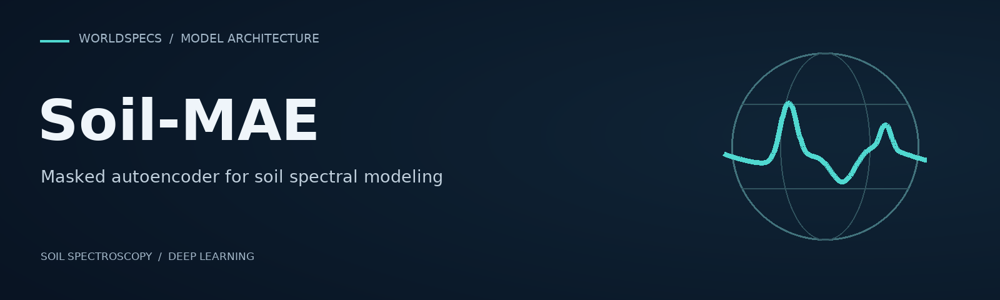

  

  <a href="https://worldspecs.soilslab.ai"><strong>WorldSpecs platform ↗</strong></a> &nbsp; · &nbsp;
  <a href="https://github.com/WorldSpecs">Research organization</a>

## Overview

**Soil-MAE** is a masked autoencoder for soil spectral modeling, developed within WorldSpecs. It learns spectral representations by reconstructing masked portions of soil spectra during self-supervised pretraining.

This repository will host the model architecture and training code accompanying the WorldSpecs manuscript, currently under review.

### Repository status

**Code and documentation are in preparation.** Installation instructions and usage examples will be provided with the code release.

| Resource | Access |
| :--- | :--- |
| Model architecture and training code | In preparation for this repository |
| Trained weights and spectral data | Not distributed |
| Soil property predictions | Available through the [WorldSpecs platform](https://worldspecs.soilslab.ai) |

## Developed by

- [Geotechnologies in Soil Science group (GeoCiS)](https://geocis.esalq.usp.br/), Luiz de Queiroz College of Agriculture, University of São Paulo, Brazil.
- [Soil Science Artificial Intelligence Laboratory](https://soilslab.ai), University of Florida, USA · [GitHub](https://github.com/Soil-Science-AI-Lab).

## Citation

The citation will be added once the manuscript is published.
